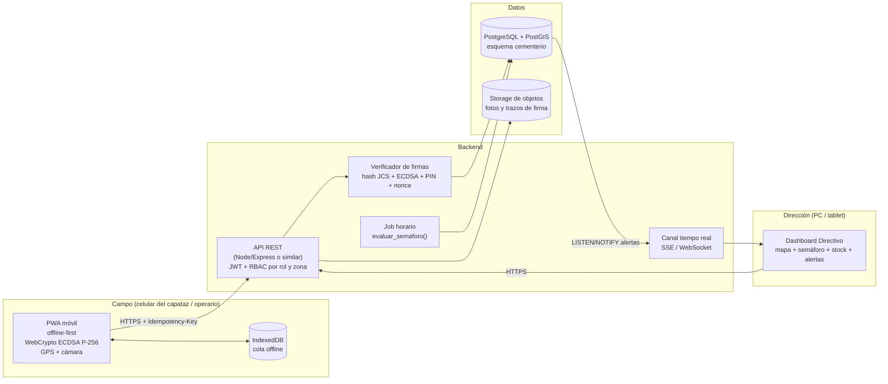
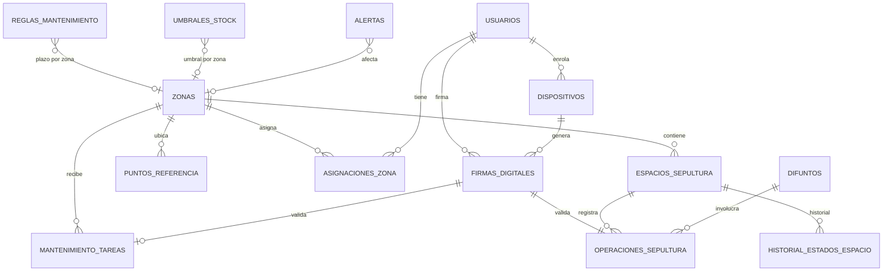
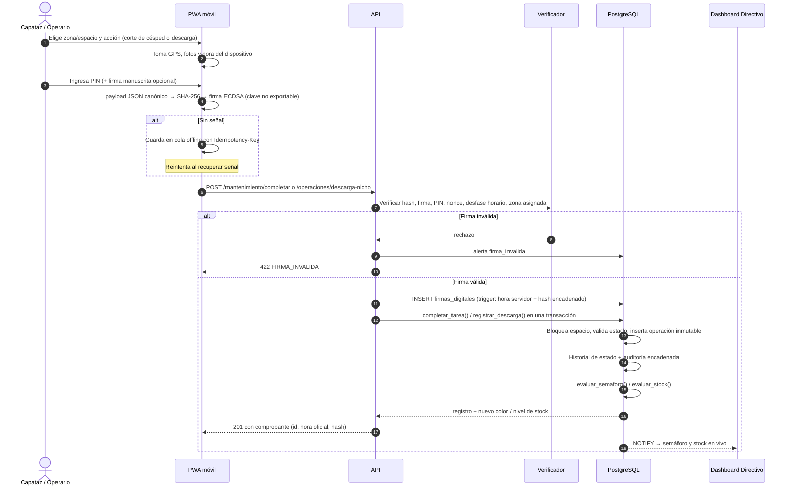
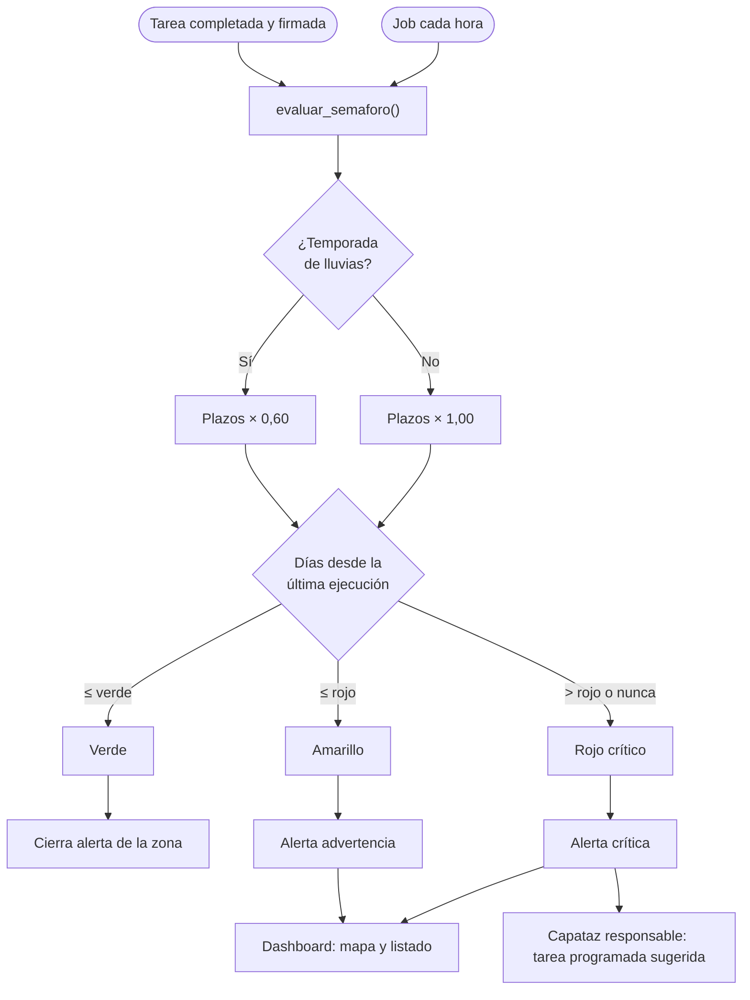
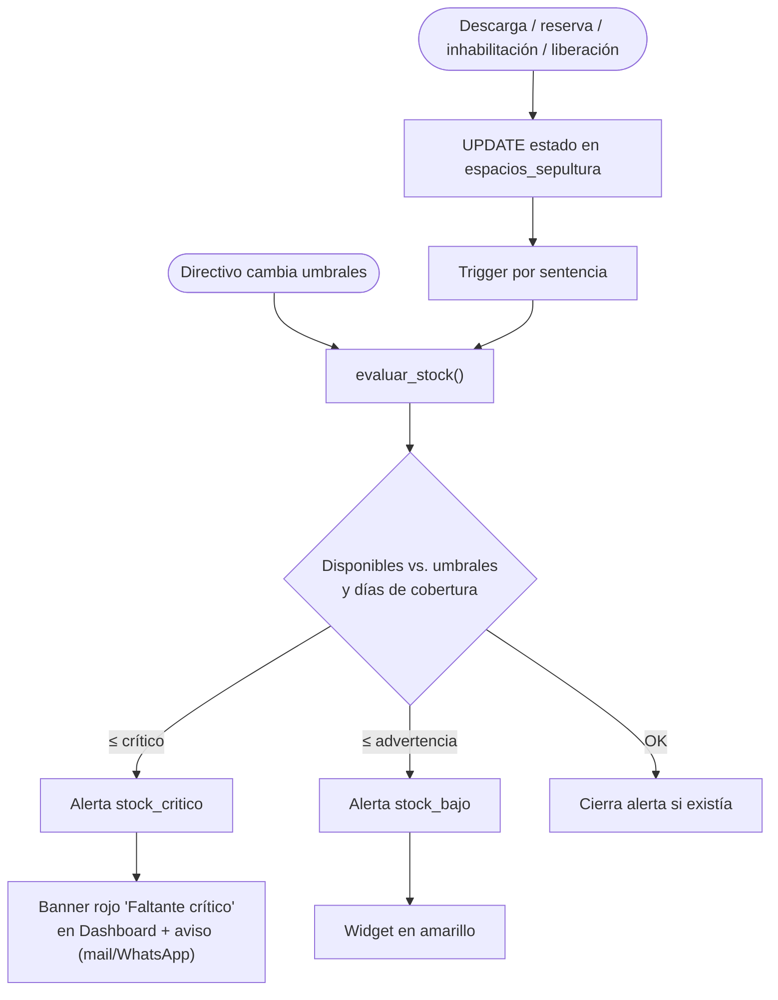

# Cementerio San Vicente Parque — Arquitectura operativa

Dirección de Cementerios · Municipalidad de Córdoba

**App web (demostración):** [`index.html`](index.html) — tablero del directivo y módulo de campo con firma.
Usuarios de prueba con PIN `1234`; los datos se guardan solo en el navegador.

Entregables:

| # | Entregable | Archivo |
|---|---|---|
| 1 | Script SQL (DDL) con tablas, ENUM, restricciones de auditoría, índices, vistas y funciones | [`esquema.sql`](esquema.sql) |
| 2 | Arquitectura, lógica de alertas y diagramas de flujo | este documento |
| 3 | Contratos de API (OpenAPI 3.0) | [`openapi.yaml`](openapi.yaml) |

---

## 1. Arquitectura técnica



**Decisiones clave**

- **PostgreSQL + PostGIS** como única fuente de verdad. Las reglas críticas
  (no ocupar dos veces un nicho, no editar lo firmado, encadenar hashes,
  recalcular stock) viven **en la base**, no solo en la API: así ninguna
  integración futura puede saltearlas.
- **Geometrías en SRID 4326** (WGS84, lo que da el GPS del celular). Zonas
  como `MultiPolygon`, puntos de referencia y espacios como `Point`. Se cargan
  al digitalizar el plano oficial (QGIS → `shp2pgsql` / `ogr2ogr`).
- **PWA offline-first**: en el predio hay sectores sin señal. Cada acción se
  firma en el momento (hora y GPS del dispositivo) y se encola; al volver la
  señal se sube con su `Idempotency-Key`, así un reintento nunca duplica.
- **Hora oficial = hora del servidor** (`registrado_en`). La del dispositivo
  se guarda aparte; si difieren más de lo tolerado (p. ej. 10 min sin marca
  offline, 72 h con marca offline) se rechaza o se genera alerta
  `sincronizacion_tardia`.

### Modelo de datos (resumen)



| Tabla | Para qué |
|---|---|
| `zonas` | Fosas: Parque (zonas 1–28), Sección Vieja y Sección Nueva. Nichos: Pabellón Amarillo, Central, Lateral y Sección Vieja. Tipo: `parque_fosas`, `nichos`, `mixta`, `especial`. Geometría. |
| `puntos_referencia` | Ingresos (Calle Soto y Calle Martin Cartechini), Administración, Cruz Mayor, Rotonda, Baños… para orientarse en campo. |
| `espacios_sepultura` | Nichos (pabellón/nivel/columna) y fosas (sección/fila/número); tamaño `normal`/`extraordinario`; estado; `version` para concurrencia. |
| `firmas_digitales` | Una por acción de campo: quién, cuándo (cliente + servidor), qué (hash), dónde (GPS), con qué dispositivo; encadenada por hash. **Inmutable.** |
| `mantenimiento_tareas` | Corte de césped, desmalezado, etc. No se puede marcar `completada` sin `ejecutada_por`, `completada_en` y `firma_id`. Cerrada = no editable. |
| `operaciones_sepultura` | Inhumación (descarga en nicho/fosa), exhumación, reducción, traslados… **Inmutable**: se corrige con una operación `anulacion`. |
| `historial_estados_espacio` | Cada cambio de estado de un nicho/fosa, con operación y usuario. **Inmutable.** |
| `auditoria_eventos` | Bitácora general encadenada por hash de altas/bajas/cambios en tablas sensibles. **Inmutable.** |
| `reglas_mantenimiento` / `temporadas_climaticas` | Plazos del semáforo y factor de temporada de lluvias. |
| `umbrales_stock` / `alertas` | Umbrales configurables de faltante y alertas abiertas/resueltas (sin duplicados). |

---

## 2. Firma digital y trazabilidad

Cada registro de campo responde **quién, cuándo, qué y dónde**, y no se puede
alterar sin que se note.

| Pregunta | Cómo se garantiza |
|---|---|
| **Quién** | Sesión JWT del usuario + dispositivo enrolado a su nombre (clave privada no exportable) + PIN personal en el momento de firmar. |
| **Cuándo** | `firmado_en_cliente` (dispositivo) y `registrado_en` (servidor, autoritativa, la pone un trigger). |
| **Qué** | `payload_sha256` = SHA-256 del JSON canónico (RFC 8785) de la acción. El servidor lo recalcula: si alguien toca un dato, no coincide. |
| **Dónde** | Punto GPS + precisión; se puede validar que caiga dentro de la geometría de la zona (`ST_Within`). |
| **Integridad** | Tablas append-only (trigger bloquea UPDATE/DELETE) y cadena de hashes (`hash_anterior` → `hash_registro`), verificable recorriendo la secuencia. |
| **Anti-replay** | `nonce` único por firma + `Idempotency-Key` por operación. |

Para valor legal pleno (Ley 25.506 de Firma Digital) se puede sumar el método
`certificado_x509` con certificados emitidos por la autoridad certificante
provincial/nacional; el esquema ya lo contempla.

---

## 3. Lógica de alertas

### 3.1 Semáforo de mantenimiento

Para cada zona y tipo de tarea con regla (`reglas_mantenimiento`):

```
factor   = 0,60 si hoy cae en temporada de lluvias (nov–mar), si no 1,00
dias     = ahora − última ejecución completada y firmada
verde        si dias ≤ dias_verde × factor
amarillo     si dias ≤ dias_rojo  × factor
rojo crítico si supera, o si nunca se registró
color de la zona = el peor color entre sus tareas
```

Valores iniciales de referencia (editables): corte de césped 15 / 30 días
(en lluvias: 9 / 18), desmalezado 30 / 60, recolección de residuos 3 / 7,
desagües pluviales 30 / 45. Se puede fijar un plazo distinto por zona.
Los sectores de nichos (Pabellón Amarillo, Central, Lateral, Sección Vieja) no evalúan corte de césped.

### 3.2 Faltante de nichos y fosas

Por cada combinación tipo × tamaño (y opcionalmente por zona):

```
crítico      si disponibles ≤ umbral_critico
             o días de cobertura (disponibles ÷ consumo diario de 90 días) ≤ dias_cobertura_critico
advertencia  si disponibles ≤ umbral_advertencia
```

Se reevalúa **automáticamente** cada vez que cambia el estado de un espacio
(trigger por sentencia) o un umbral. Una alerta abierta no se duplica: se
actualiza; cuando el stock se recupera, se cierra sola.

---

## 4. Flujos de trabajo

### 4.1 Ejecución en campo con firma digital



### 4.2 Actualización del semáforo



### 4.3 Alerta por faltante de nichos y fosas



---

## 5. Componentes de interfaz

### Tablero (escritorio, tablet o celular)

Lo ven todos: directivos, capataces y operarios. Los ajustes de umbrales y plazos son solo para directivos.

- **Banner "Faltante crítico"** fijo arriba cuando `faltante_critico = true`,
  con el detalle (p. ej. "Nichos extraordinarios: 9 disponibles · ~12 días de cobertura").
- **Widget de disponibilidad**: 4 tarjetas (Nicho normal, Nicho extraordinario,
  Fosa normal, Fosa extraordinaria) con disponibles, barra contra umbrales,
  días de cobertura y tendencia de 90 días. Click → listado filtrado por zona.
- **Mapa del predio** (Leaflet/MapLibre sobre el plano georreferenciado): zonas
  pintadas con el color del semáforo, puntos de referencia (accesos, Cruz Mayor,
  Rotonda…) y capa de espacios disponibles.
- **Tabla de semáforo** de las zonas del Parque y los sectores de fosas y nichos, ordenable por
  criticidad, con última ejecución, responsable y días restantes.
- **Bandeja de alertas** con "marcar como vista" y configuración de umbrales.
- **Trazabilidad**: buscador por espacio, difunto, operario o fecha; muestra
  la cadena completa (operación → firma → hash) y verifica integridad.

### Módulo de campo (Capataces / Operarios, celular)

- Inicio con **mis zonas asignadas** y su color, y tareas pendientes.
- **Registrar tarea**: zona (preseleccionada por GPS), tipo, % cubierto, fotos,
  observaciones → pantalla de **conformidad** con resumen, PIN y trazo de firma.
- **Registrar descarga**: buscar espacio disponible (filtro tipo/tamaño/zona,
  "más cercano"), datos del difunto y expediente, confirmación con firma.
- Botones grandes, alto contraste para sol directo, funciona sin señal con
  indicador de "pendiente de envío".
- Comprobante final con hora oficial y código de verificación (hash corto).

---

## 6. Puesta en marcha

1. Crear base PostgreSQL 15+ con PostGIS (p. ej. Supabase) y ejecutar `esquema.sql`.
2. Confirmar con el plano los límites de cada zona y sector.
3. Digitalizar geometrías de zonas y puntos de referencia.
4. Cargar el padrón de nichos y fosas existente (CSV → `COPY`).
5. Ajustar plazos de mantenimiento, temporada de lluvias y umbrales de stock.
6. Dar de alta usuarios y enrolar los celulares de los capataces.
7. Programar `SELECT cementerio.evaluar_semaforo();` cada hora (pg_cron).
